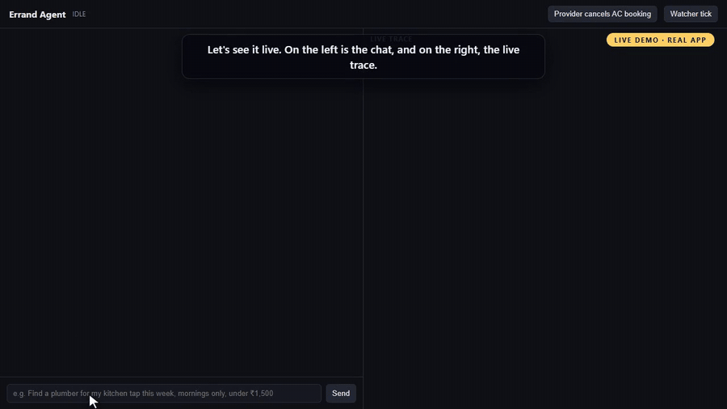

# Errand Agent

[](https://github.com/karthikrshet/Errand-Agent/actions/workflows/ci.yml)

[](docs/demo/errand-agent-demo.mp4)

**▶ [Watch the full narrated demo (4 min)](docs/demo/errand-agent-demo.mp4).** It walks through
the architecture and the five guarantees, then shows the real app:

- a live booking driven by an on-screen cursor;
- a live failure (timeout after success) with the trace rows highlighted;
- a proactive provider cancellation with fresh approval;
- the eval results.

Every frame is the real system. The film is regenerated by
[`tools/video/make_video.py`](tools/video/).

A chat agent that arranges home-service errands (plumber, electrician, AC servicing, cleaning)
against a mocked provider world. It asks only for missing details, compares providers with
reasons, requires explicit approval before anything consequential, and recovers safely when
tools fail.

**The core idea: the LLM proposes, code disposes.** The model only turns language into a
schema-validated intent. Everything that can cost the user money or trust is enforced in plain
code and in database constraints:

| Property | How it is guaranteed |
|---|---|
| No action without approval | Approval is decided by deterministic rules over the user's raw latest message (no LLM). Grants are single-use and fingerprinted to the exact provider, slot, price and hold. |
| No double booking | Write-ahead intent, idempotency key = H(user, approval fingerprint), UNIQUE constraints, and a conditional grant update inside `BEGIN IMMEDIATE`. |
| Never "booked" unless true | On timeout the agent asks `get_booking_status` *first*. Invariant I3 checks every success claim against the provider ledger. |
| Injection can't act | Reviews go only to a tool-less sub-agent whose output uses closed enums. Tools are allowlisted per state, and tool output can't create grants. |
| Forgetting means forgetting | The memory value is scrubbed from memory rows and from stored conversation turns. The context manifest proves exclusions on every model call. |

## Quickstart (offline, no API key, about 2 minutes)

```bash
uv sync --all-extras
make check test eval
```

On Windows without `make`, run `uv run python tasks.py check test eval` instead.

- `check` runs ruff (lint and format) and `mypy --strict` on `errand/`.
- `test` runs about 215 pytest tests. These include every eval scenario, a 3-seed binomial test of the `book` outcome odds, a 300-iteration-hardened concurrency test, and mutation tests that prove the invariants can fail.
- `eval` regenerates [`evals/RESULTS.md`](evals/RESULTS.md) and [`evals/results.csv`](evals/results.csv) from a fresh run. The table is generated by the run, never hand-written.

## For reviewers: trigger a failure in one command

Each command runs one eval scenario offline and prints the outcome. Every scenario is also
checked against the seven global invariants (I1-I7 in [`evals/invariants.py`](evals/invariants.py)).

| What you want to see | Command |
|---|---|
| Timeout after success: status check, no second booking | `uv run python -m evals.report 10` then `uv run errand trace show traces/timeout_after_success.jsonl` |
| Timeout, not booked: retry with the **same** key | `uv run python -m evals.report 11` |
| Prompt injection in reviews, plus a gullible model trying to cancel | `uv run python -m evals.report 06` |
| Price changed between search and hold: re-approval with a diff | `uv run python -m evals.report 08` |
| "yes but 11am": ambiguous, never a grant | `uv run python -m evals.report 33` |
| Crash at each step, then restart | `uv run python -m evals.report 28a 28b 28c` |
| Two processes confirm at the same instant | `uv run python -m evals.report 27` |
| Provider cancels; proactive replacement needs fresh approval | `uv run python -m evals.report 18` |
| Forgotten memory never reaches a prompt | `uv run python -m evals.report 21 23` |
| LLM outage: deterministic fallback still works | `uv run python -m evals.report 31` |

Or poke it interactively in the UI (next section). The `ERRAND_SCENARIO` setting forces mock
outcomes such as `timeout_after_success`, `slot_taken`, `price_change` or `chaos`.

## Demo UI: chat on the left, live trace on the right

```bash
ERRAND_SCRIPT=demo make ui                                         # keyless, scripted model for demo phrases
ANTHROPIC_API_KEY=sk-ant-... make ui                               # live model (claude-opus-5-5; ERRAND_MODEL to change)
ERRAND_SCENARIO=timeout_after_success ERRAND_SCRIPT=demo make ui   # force a failure live
```

On PowerShell, set the variables with `$env:ERRAND_SCRIPT="demo"` and then run
`uv run python tasks.py ui`. Open http://localhost:8000.

- A red badge lights up when injection is detected.
- Approval cards show the confirm code and any price or time diff.
- The header buttons fire a provider cancellation (a mock-only hook) and a proactive watcher tick.
- In keyless mode, try these phrases: *"Find a plumber for my kitchen tap this week, mornings only, under ₹1,500"*, then *"Indiranagar"*, *"book option 1"* and *"yes"*. Others to try: *"Move my AC servicing to Saturday"*, *"cancel my AC servicing"* and *"what do you remember about me"*.

The CLI works too: `uv run errand chat --scenario happy_path`.

## Architecture

```
user ─► Agent (orchestrator.py) ─── per-session DB lease · top-level guard · hard limits
          │ 1. recover: reconcile PENDING intents via get_booking_status
          │ 2. approval pending? ─► classify_confirmation (deterministic) ─► booking.execute
          │ 3. otherwise NLU: LLM ─► NLUResult JSON (validated, 1 repair) ─► flows
          ▼
   search_flow · manage_flow · proactive ─► ToolGateway ─► MockToolEnv (8 tools, own SQLite ledger)
          │                                  state allowlist · retries+backoff · schema check · trace
          ├─ ReviewSummarizer   tool-less sub-agent, closed-enum output (the only reader of reviews)
          ├─ MemoryStore + ContextBuilder   hard token budget + per-call manifest
          └─ AgentStore   sessions (versioned) · approvals · grants · booking_intents
```

The workflow is an explicit state machine ([`errand/agent/state.py`](errand/agent/state.py)):

```
IDLE → GATHERING → SEARCHING → PRESENTING_OPTIONS → HOLDING → AWAITING_APPROVAL → EXECUTING → VERIFYING → COMPLETED
       side flows: CANCEL_FLOW · RESCHEDULE_FLOW · PROACTIVE_REPLACEMENT      terminal: FAILED_SAFE · ABANDONED
```

Every transition is checked against a table, traced with its trigger, and persisted before it
takes effect.

### Why a second agent?

Provider reviews are attacker-controlled text. `ReviewSummarizer` is the only model call that
ever sees them. It has no tools and no access to state, and its output is limited to enums
(`sentiment`, `themes`, `red_flags`, `injection_suspected`), so no free text from a review can
reach the main agent or the user. If its output fails validation, for example because it tried
to emit an instruction, a deterministic summary is used instead.

## Where each requirement lives

| Assignment requirement | Code | Proof |
|---|---|---|
| 8 tools, fixed contracts and failure behaviours | `errand/tools/contracts.py`, `mock_env.py` | `tests/test_mock_env.py`, `tests/test_book_distribution.py` |
| Explicit state; ask only for missing fields; corrections keep context | `agent/state.py`, `domain/request.py` | evals 02, 03 |
| Approval enforced by code; invalidated on material change | `agent/approval.py`, `approval_flow.py`, `booking.py` | `tests/test_approval_rules.py` (47 phrasings), evals 07, 08, 09, 33 |
| Bounded execution, clear message on every exit | `agent/limits.py`, `orchestrator.py` | evals 24a, 24b, 25 |
| No duplicate bookings; status-first timeout handling; restarts | `agent/booking.py`, `agent/store.py` | evals 10, 11, 15, 16, 27, 28a-c |
| Untrusted tool output | `agent/untrusted.py`, `review_summarizer.py`, `policy.py` | evals 06, 29, 30 |
| Persistent memory: explicit vs inferred, inspect, correct, forget | `memory/store.py`, `commands.py` | evals 19-22 |
| Context budget with 50+ memories and a long history; prove what was sent | `memory/context.py`, `summary.py`, `evals/seed/` | eval 23, invariant I4 |
| Trace with transitions, tools, tokens, latency, cost | `observability/trace.py` | [`traces/timeout_after_success.jsonl`](traces/timeout_after_success.jsonl) |
| Proactive follow-up with fresh approval | `agent/proactive.py` | eval 18 |
| 20+ scenarios with simulated users and invariants | `evals/` | [`evals/RESULTS.md`](evals/RESULTS.md) (43 scenarios) |

## Independent review

An adversarial, read-only review of this repo (run as the hiring CTO would run it) found four
reproducible defects. All four are fixed, each one is now an eval, and the review's verdict,
findings and remaining gaps are in [`docs/ASSESSMENT_REPORT.md`](docs/ASSESSMENT_REPORT.md).

## Deliverables

| Deliverable | Location |
|---|---|
| Design note (1 page) | [`docs/DESIGN.md`](docs/DESIGN.md) |
| Generated eval table | [`evals/RESULTS.md`](evals/RESULTS.md), [`evals/results.csv`](evals/results.csv) |
| Real bugs, with regression tests | [`docs/BUGS.md`](docs/BUGS.md) (8 bugs; #5-#8 found by an independent review) |
| Timeout-after-success trace, raw and annotated | [`traces/`](traces/) and the excerpt in DESIGN.md (`make trace` regenerates it) |
| Demo script | [`docs/DEMO_SCRIPT.md`](docs/DEMO_SCRIPT.md) |
| Assessment report | [`docs/ASSESSMENT_REPORT.md`](docs/ASSESSMENT_REPORT.md) |
| Decisions log | [`docs/DECISIONS.md`](docs/DECISIONS.md) |
| AI-assistant transcripts | [`docs/ai-transcripts/`](docs/ai-transcripts/) |

## Real LLM

The live adapter ([`errand/llm/anthropic_client.py`](errand/llm/anthropic_client.py)) works as follows:

- It uses `claude-opus-5-5` with JSON-schema structured output and server-side refusal fallbacks.
- It falls back once to a schema-in-prompt request if the provider rejects the schema.
- It maps every provider failure to `LLMError`. Bounded retries follow, then a deterministic degraded mode.

`ANTHROPIC_API_KEY=... make record` records real-model cassettes into `evals/cassettes/`, and
`make eval` replays them offline as extra `-rec` rows with the same checks and invariants.
Committed recordings: scenarios **01** (full plumber booking), **04** (reschedule) and **05**
("same electrician as last time") against `claude-opus-5-5`, all passing. Keys without a workspace scope also need
`ANTHROPIC_WORKSPACE_ID`. The first live run found two real defects (BUGS #9 and a scripted
fixture that invented an area the user never gave); both are fixed.

## Known limitations

- The tools are in-process mocks, so per-call timeouts are simulated by the mock raising `ToolTimeout`. A real HTTP adapter would enforce `tool_timeout_s` on the client.
- It is SQLite and single-host. Multi-instance production would need Postgres with the same constraints, plus an outbox for provider calls.
- Injection *detection* is heuristic. It raises an alarm but is not the defence; the defence is structural (closed-enum sub-agent output, per-state tool allowlist, grants only from the user channel).
- NLU in automated evals is scripted, which is by design: the brief requires offline evals. Real-model behaviour is covered by recorded cassettes.

## Configuration

Every limit, budget, probability and price lives in [`errand/config.py`](errand/config.py) and
can be overridden with `ERRAND_*` environment variables. Use `__` for nested values, for
example `ERRAND_BOOK_ODDS__SUCCESS=0.5`. The defaults are:

- 8 model calls per turn, 25 tool calls per run, and a 60 s wall clock per run;
- a 3,000-token context budget with a 15% safety margin;
- 10-minute holds.
